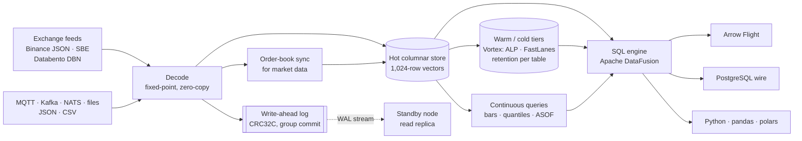
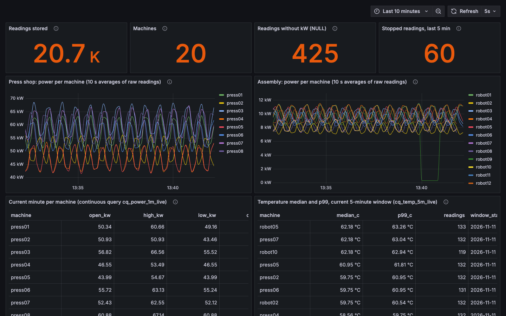

# ANKAA

### Real-time time-series engine for Arm servers. Stream in, query in milliseconds.

**ANKAA ingests live streams (MQTT, Kafka, NATS, exchange feeds, files), makes every reading queryable with SQL within milliseconds, keeps live aggregates up to date as data arrives, compresses history to disk, and serves it all over Arrow Flight, the Postgres protocol and Python. One Rust binary, tuned for Arm cloud CPUs such as AWS Graviton, Google Axion and Azure Cobalt.**

**Website:** [ualsweb.github.io/ankaa](https://ualsweb.github.io/ankaa/) · [Measurements](https://ualsweb.github.io/ankaa/benchmarks.html) · [Documentation map](https://ualsweb.github.io/ankaa/docs.html)

[](LICENSE)
[](https://github.com/ualsweb/ankaa/actions/workflows/ci.yml)


| What it is | Built for | Replaces |
|---|---|---|
| A **streaming time-series database**: readings in from devices, brokers and feeds, SQL and Arrow out, live aggregates maintained continuously, history compressed on disk | Industrial and IoT telemetry, energy and metering, fleets, capital markets, platform teams on Kafka, NATS or MQTT | The glue between a message broker, a stream processor, a batch job, a Parquet folder and a dashboard that polls them |

**Proven on the hardest feed, built for every time series.** Exchange market data is the most demanding real-time stream there is (bursts, strict sequence numbers, nanosecond time, exact decimals, order books that must never drift), so ANKAA was built and verified on it first. The same storage, durability, live aggregates and SQL serve any table you declare: per-device partitions and late-data windows, nullable readings, retention per table, MQTT topic mapping.

---

## The problem

Fresh data and fast queries usually live in different systems.

- **On a production line** a press starts drawing 15 % more power at 02:00. By morning someone asks for per-machine power bars through the night and the p99 over the last five minutes. The readings were on the MQTT broker all along; answering takes a stream processor, a database, a scheduled job and a dashboard that polls them.
- **On a trading desk** the book moves 2 % in four seconds. Next morning someone asks for the quote in force at every trade, one-second bars through the move and the 99th-percentile spread. The answer is a capture file, an order-book rebuild and an afternoon in pandas.

In both cases the data existed. It was not *queryable while it was fresh*.

**ANKAA makes it a query**, on data that arrived milliseconds ago and data from last month alike:

```sql
-- market data
SELECT * FROM asof_join('trades', 'quotes', 'symbol');              -- quote in force at every trade
SELECT * FROM ohlcv('trades', 1000000000);                          -- 1 s bars

-- any feed, declared in the config and fed from MQTT / Kafka / NATS
SELECT * FROM cq_power_1m_live;                                     -- live 1-minute bars, maintained as data arrives
SELECT * FROM percentiles('power', 'kw', '0.5,0.99', 'machine');    -- streaming quantiles per machine
SELECT count(*) FROM power WHERE kw IS NULL;                        -- readings that came without a value
```

---

## What it does



| Capability | What you get |
|---|---|
| **Market-data ingest** | Binance WebSocket (JSON and SBE binary), REST depth snapshots aligned with diffs, sequence-gap detection and resync; replay of captures and Databento DBN files through the same code path |
| **Bring your own feed** | Declare a table (`timestamp_ns`, `fixed8`, `int64`, `dict`, `u8`, `float64`, any of them `nullable`) and feed it from **MQTT** (TLS and client certificates, topic segments as columns, persistent sessions), **Kafka** (saved offsets), **NATS** or files, JSON or CSV, with exact decimal parsing ([guide](docs/generic-ingest.md)) |
| **Time semantics** | Per-key watermarks; a bounded lateness window per table inserts late readings at their place in time (gateways that buffer, devices that reconnect); event-time continuous queries that rebuild to the same result after a crash ([time semantics](docs/temporal-architecture.md)) |
| **Continuous queries** | OHLCV bars, quantiles and ASOF joins maintained incrementally as rows arrive, readable as ordinary tables (`cq_<name>`, `cq_<name>_live`) ([guide](docs/continuous-queries.md)) |
| **Exact order books** | L2 books rebuilt from snapshot + diffs, top of book once per exchange message, crossed-book detection |
| **Storage** | Columnar in-memory chunks with zone maps and 1,024-row block statistics; validity bitmaps for missing values; sealed chunks compressed with Vortex (ALP, FastLanes, dictionary) into memory and disk segments; retention per table in event time; queries span hot, warm and cold data transparently; tested with 100,000 devices in one table |
| **Durability** | Write-ahead log with CRC32C and group commit, crash recovery, checkpoints that truncate the log. **1,000 simulated power cuts, zero acknowledged writes lost** |
| **Replication** | A standby streams the primary's log over Arrow Flight, serves read-only queries and can be promoted ([guide](docs/replication.md)) |
| **Query** | SQL through Apache DataFusion with time-range and key pruning and parallel scans · hash-free aggregation over symbols, flags and time buckets that answers from per-block statistics where it can · `asof_join`, `ohlcv`, `rolling` and `percentiles` table functions |
| **Interfaces** | Arrow Flight (TLS, mutual TLS, tokens, read-only SQL), PostgreSQL wire protocol (`psql`, BI tools), Python with zero-copy Arrow, Prometheus metrics and a Grafana dashboard |
| **Arm-native compute** | Scan kernels for scalar, NEON and **SVE2**, vector-length agnostic, checked on 128-, 256- and 512-bit vectors |
| **Operations** | One binary, one TOML file, systemd unit, alert rules, fail-fast config checks, bounded query memory and timeouts |

**What it is not:** a distributed big-data platform, a general stream processor, a trading engine or a managed service. ANKAA is a single-node engine that scales up on one Arm server, with a standby for read scaling and failover.

---

## Who it is for

| You are… | You use ANKAA to… |
|---|---|
| **A manufacturing or industrial IoT team** | Subscribe to the plant's MQTT broker, map line and machine from the topic, keep per-machine bars and percentiles live, query months of history on one box |
| **An energy, utility or metering team** | Store meter and asset readings with exact decimals, keep quarter-hour aggregates continuously, expire raw data on a retention window |
| **A fleet, mobility or sensor team** | One partition per device with its own ordering and late-data window, so a device that reconnects never holds back the rest |
| **A trading or digital-asset team** | Capture full-depth books from public feeds 24/7, query them live, replay them for research |
| **A quant researcher** | Get ASOF joins, bars and quantiles in SQL or pandas without writing book-reconstruction code |
| **An exchange, venue or data vendor** | Store and serve your own feeds, watch gaps and latency, give clients SQL and Arrow access |
| **A platform or observability team** | Turn a busy topic into queryable tables and live aggregates without adding a stream processor and a separate database |
| **An Arm or cloud ecosystem partner** | Showcase a real-time data workload designed around SVE2 and Neoverse |

---

## Try it

### The factory demo: one command

A simulated plant publishes to an MQTT Unified Namespace; ANKAA stores and aggregates it live; Grafana
shows it over the Postgres protocol. Requires Docker with Compose.

```sh
git clone https://github.com/ualsweb/ankaa && cd ankaa/examples/factory
docker compose up -d          # then open http://localhost:3000
```

What it shows and how to point it at your own broker: [`examples/factory`](examples/factory/) and the
[Unified Namespace tutorial](docs/tutorials/uns-historian.md).



<details>
<summary>The same data from a terminal (55-second recording)</summary>


</details>

### Install

- **Container image** (linux/arm64, linux/amd64): `docker run --rm -e ANKAA_TOKEN=change-me-to-16-chars -p 50051:50051 -p 5432:5432 -p 9100:9100 ghcr.io/ualsweb/ankaa:latest`, with your configuration mounted at `/etc/ankaa/ankaad.toml` ([`deploy/docker/ankaad.toml`](deploy/docker/ankaad.toml) is the default).
- **Binaries** for Linux arm64, Linux x86-64 and macOS arm64 are attached to each [release](https://github.com/ualsweb/ankaa/releases).
- **From source**: Rust 1.95 or newer, `cargo build --release -p ankaad`.

### Query a market-data capture in 60 seconds

No account, no network needed. Requires [Rust](https://rustup.rs).

```sh
git clone https://github.com/ualsweb/ankaa && cd ankaa

# Replay a bundled 20-second Binance capture and query it
cargo run --release -p ankaad -- replay bench/data/binance-btcusdt-trade-depth-20s.ankc \
  --sql "SELECT s.name, count(*) AS trades, min(price)/1e8 AS low, max(price)/1e8 AS high
         FROM trades t JOIN symbols s ON s.symbol = t.symbol GROUP BY s.name" \
  --sql "SELECT * FROM ohlcv('trades', 1000000000) LIMIT 5"
```

### Run it as a server

```sh
# Live Binance streams → SQL over Arrow Flight, Postgres and /metrics (loopback only)
ANKAA_TOKEN=devtoken cargo run --release -p ankaad -- serve \
  --streams btcusdt@trade,btcusdt@depth@100ms,ethusdt@trade,ethusdt@depth@100ms \
  --pg-addr 127.0.0.1:55432
#   offline? add: --url file://bench/data/binance-btcusdt-trade-depth-20s.ankc --no-depth-snapshots

# In another terminal
ANKAA_TOKEN=devtoken cargo run --release -p ankaad -- query \
  --sql "SELECT s.name, count(*) AS quotes, avg((ask - bid)/1e8) AS avg_spread
         FROM quotes q JOIN symbols s ON s.symbol = q.symbol GROUP BY s.name"
PGPASSWORD=devtoken psql -h 127.0.0.1 -p 55432 -U ankaa -c "SELECT count(*) FROM trades"
```

### Bring your own feed (MQTT example)

```toml
# ankaad.toml
[[tables]]
name = "power"
partition_by = "machine"             # ordering and late-data window per machine
max_lateness_ms = 300000             # gateways that buffer up to five minutes
retention = "180d"                   # measured from the newest reading
columns = [ { name = "ts", type = "timestamp_ns" }, { name = "line", type = "dict" },
            { name = "machine", type = "dict" },
            { name = "kw", type = "float64", nullable = true } ]

[[sources]]
name = "plant1"
kind = "mqtt"                        # or "kafka", "nats", "file"
url = "mqtt://broker.plant1:1883"
subject = "plant1/+/+/power"         # plant1/<line>/<machine>/power
format = "json"                      # or "csv"
table = "power"
ts_unit = "millis"
map = { ts = "t", line = "$topic.1", machine = "$topic.2", kw = "kw" }

[[continuous]]
name = "power_1m"                    # → tables cq_power_1m and cq_power_1m_live
kind = "ohlcv"
table = "power"
key = "machine"
value = "kw"
width_ns = 60000000000
```

```sh
ANKAA_TOKEN=devtoken cargo run --release -p ankaad -- serve --config ankaad.toml
```

### From Python

```python
import ankaa

ds = ankaa.open_capture("bench/data/binance-btcusdt-trade-depth-20s.ankc")   # in-process
bars = ds.sql("SELECT * FROM ohlcv('trades', 1000000000)").to_pandas()

live = ankaa.connect("127.0.0.1:50051", token="devtoken")                    # over Arrow Flight
power = live.sql("SELECT * FROM cq_power_1m_live").to_pandas()
```

Build the package with `pip install maturin && maturin develop` in `crates/ankaa-py`; the notebook is in [`examples/python/`](examples/python/).

---

## Why ANKAA is different

**1. Streaming and querying in one engine.** Ingest, durable storage, live aggregates and SQL run in the same process on the same data. There is no gap between "the stream" and "the database", and no extra system to keep in sync.

**2. Built for Arm, not ported to it.** Arm servers are the most cost-efficient compute in every major cloud. The hot loops target Arm's SVE2 vector instructions without assuming a vector width, so the same binary is correct on today's 128-bit cores and future wider ones.

**3. Verified, not just tested.** SIMD kernels are checked against a scalar reference at three vector lengths. Query results are checked against DuckDB and Polars (31 differential checks), and nullable tables against DataFusion's own engine across every storage tier. The write-ahead log survived 1,000 simulated power cuts. MQTT, Kafka and NATS sources run end to end against real brokers in CI. Parsers are fuzzed, and independent QA and security reviews ran before publication.

**4. Honest numbers or no numbers.** No benchmark appears here until it was measured on named Arm server hardware with scripts anyone can rerun ([measurement protocol](docs/measurement-protocol.md), [comparison method](docs/benchmarks/comparison-method.md)). The comparison harness against DuckDB, ClickHouse and QuestDB is in the repo; its preliminary runs on a small Axion VM are [published with scripts and raw results](https://ualsweb.github.io/ankaa/benchmarks.html) as what they are: a way to find our own problems, not a result.

**5. Open standards end to end.** Apache Arrow in memory and on the wire, Apache DataFusion for SQL, the Postgres protocol for tools, MQTT, Kafka and NATS for input, Vortex for compression. No proprietary query language, no lock-in.

**6. Precise by default.** Decimals are stored as fixed-point integers (no float rounding), event and receive times are kept separately, sequence gaps are detected, a missing reading is `NULL` rather than a made-up zero, and late data is placed in time within a declared window and counted beyond it, never silently merged.

---

## Project status

Pre-alpha. The software is implemented and tested end to end; the gates that need real hardware or wall-clock time are still open.

| Area | State |
|---|---|
| Market-data ingest, replay, order books, storage tiers, WAL, SQL, Flight, Postgres wire, Python, metrics | ✅ Implemented and verified end to end on live Binance data |
| Generic tables with MQTT, Kafka, NATS and file sources | ✅ Verified end to end against real Mosquitto, Kafka and NATS brokers (also in CI) · MQTT (persistent session), file and Kafka sources lose nothing across restarts (at least once); NATS core is at most once |
| Late data, missing values, retention | ✅ Bounded lateness per table with in-order insertion, nullable columns through WAL, tiers and recovery, retention per table; covered by crash, restart and lost-WAL tests |
| Continuous queries, standby replication | ✅ Implemented and end-to-end tested, including restarts and crashes · event time with the table's lateness; readings beyond it are dropped and counted (no retraction) · replication is asynchronous, failover is manual |
| SVE2 kernels | ✅ Correct at VL 128/256/512 under emulation and on Neoverse V2 silicon (Google Axion) · the engine chooses per kernel: NEON for most at 128-bit vectors, SVE2 for 64-bit integer min/max, where it is faster ([first light](docs/benchmarks/2026-11-10-axion-first-light.md)) |
| Performance on Graviton4 / Axion | ⏳ First single-VM measurements, and a preliminary comparison with DuckDB, ClickHouse and QuestDB on one hour of live data on a 4-vCPU Axion VM, are [published with their scripts and raw results](docs/benchmarks/2026-11-10-axion-first-light.md); a full benchmark is not done yet: **no performance claims are made** |
| Live soaks on Google Axion | ✅ Release build v0.1.0: 3 h clean on live Binance streams (10.96 M rows, 0 gaps, 0 drops, 0 WAL errors) with WAL, segments, retention and continuous queries, after a passing crash test ([measurements](https://ualsweb.github.io/ankaa/benchmarks.html#soak)) · ⏳ 24-hour run in progress |
| Distributed queries across nodes | ❌ Not planned for v1 (scale up on one Arm server; standby for reads) |
| Production use | ❌ Not yet. Interfaces may change before 1.0 |

Details: [STATUS](docs/STATUS.md) · [ROADMAP](docs/ROADMAP.md) · [CHANGELOG](CHANGELOG.md).

---

## Working with the project

ANKAA is **Apache-2.0** open source, free to use, modify and run commercially.

- **Design partners.** If your team runs plant, meter, fleet, market-data or other telemetry workloads and wants to shape the engine, run it on your feeds or test it on Arm hardware: what you get and what we ask is on [one page](docs/design-partners.md). Open a [GitHub Discussion](https://github.com/ualsweb/ankaa/discussions) with the *Design partner* label to start. Early partners get direct input on the roadmap.
- **Hardware and cloud partners.** Access to Arm server instances for public, reproducible benchmarks is the most valuable contribution right now.
- **Contributors.** Start with [`CONTRIBUTING.md`](CONTRIBUTING.md) (DCO sign-off, RFC process for design changes). Good first areas: new sources and decoders ([framing helper](crates/ankaa-ingest/examples/custom_feed.rs), [generic mapper](crates/ankaa-ingest/src/generic.rs)), SQL functions, docs.
- **Security reports.** See [`SECURITY.md`](SECURITY.md).

The project is maintained by an independent engineer with a background in telecom systems and Arm firmware, and is developed with AI assistance: every change goes through the same tests, differential checks, fuzzing and review gates described above.

---

## Documentation

| Start here | Operate it | Go deeper |
|---|---|---|
| [Architecture](docs/architecture.md) | [Deployment guide](docs/deployment.md) | [Product requirements](docs/prd/PRD-v4.1.md) |
| [Bring your own feed](docs/generic-ingest.md) | [Replication and failover](docs/replication.md) | [Continuous queries](docs/continuous-queries.md) |
| [Data model](docs/data-model.md) | [`deploy/`](deploy/): systemd, Prometheus, Grafana, example config | [Time semantics](docs/temporal-architecture.md) |
| [Python quickstart](examples/python/) | [Metrics reference](docs/metrics-semantics.md) | [Measurement protocol](docs/measurement-protocol.md) |
| [Status and known gaps](docs/STATUS.md) · [Launch checklist](docs/launch-checklist.md) | [Security model](docs/security.md) | [Decisions (ADRs)](docs/decisions/) · [Unsafe policy](docs/unsafe-policy.md) |

<details>
<summary><b>Reference: tables, functions, inputs, configuration</b></summary>

**Market-data tables** (prices and sizes are fixed-point `i64` with 8 decimals; divide by `1e8` in SQL)

| Table | Columns |
|---|---|
| `trades` | `ts, symbol, price, size, side, seq` |
| `book_deltas` | `ts, symbol, side, price, size, first_update_id, update_id` (L2 updates as applied; snapshot levels have `first_update_id = 0`) |
| `quotes` | `ts, symbol, bid, bid_size, ask, ask_size, update_id` (top of book after each exchange message) |
| `symbols` | `symbol, name` |

**Your tables:** whatever `[[tables]]` declares; names behind `dict` columns are in `dictionaries(table, column, id, name)`. Continuous queries appear as `cq_<name>` (closed results) and `cq_<name>_live` (open bar or window per key).

**Table functions**

| Function | Meaning |
|---|---|
| `asof_join(left, right, key [, tolerance_ns [, 'forward']])` | For every left row, the latest (or next) right row with the same key |
| `ohlcv(table, width_ns [, key])` | Open, high, low, close, volume, notional and count per time bucket |
| `rolling(table, window_ns, step_ns [, key])` | Bars over a trailing window at every step (rolling high/low/volume/VWAP), in time independent of the window length |
| `percentiles(table, column, 'q1,q2,…' [, key])` | Streaming quantiles (UDDSketch, 1 % relative error) |
| `vwap(price, size)` | Aggregate: volume-weighted average price with exact integer sums |

**Inputs:** MQTT topic filters, Kafka topics and NATS subjects (JSON or CSV); live Binance JSON and SBE streams; `.ankc` captures (`ankaa-capture` records them); Databento `.dbn`/`.dbn.zst`; `.csv` and `.parquet` trade files; NDJSON/CSV files; user-defined binary feeds through the framing helper.

**Configuration:** `ankaad serve --config file.toml`; `ankaad config print` shows defaults, `ankaad config check` validates without side effects. Annotated example: [`deploy/ankaad.example.toml`](deploy/ankaad.example.toml).

</details>

<details>
<summary><b>Building and testing from source</b></summary>

Requires Rust 1.95 or newer (the toolchain file pins 1.99.1). aarch64 Linux is the first-class target; x86-64 builds and runs the scalar path; macOS on Apple Silicon is supported for development.

```sh
cargo nextest run --workspace --all-features         # native tests (NEON on Arm)
sudo apt-get install -y qemu-user                    # SVE2 tests on CPUs without SVE
cargo qtest128 && cargo qtest256 && cargo qtest512   # SVE2 differential tests under QEMU
bench/oracle/run.sh                                  # SQL results vs DuckDB and Polars
ANKAA_BROKER_TESTS=1 cargo test -p ankaad --test brokers   # needs NATS :4222, Kafka :9092, MQTT :1883
```

The broker containers are listed at the top of [`bins/ankaad/tests/brokers.rs`](bins/ankaad/tests/brokers.rs). On macOS the SVE2 suite runs inside a Linux VM: see [`docs/dev-environment.md`](docs/dev-environment.md) and `scripts/vm-qtest.sh`.

</details>

---

## License

[Apache License 2.0](LICENSE). Contributions are accepted under the Developer Certificate of Origin (`git commit -s`).

<sub>*Ankaa* is the brightest star of the Phoenix constellation.</sub>
